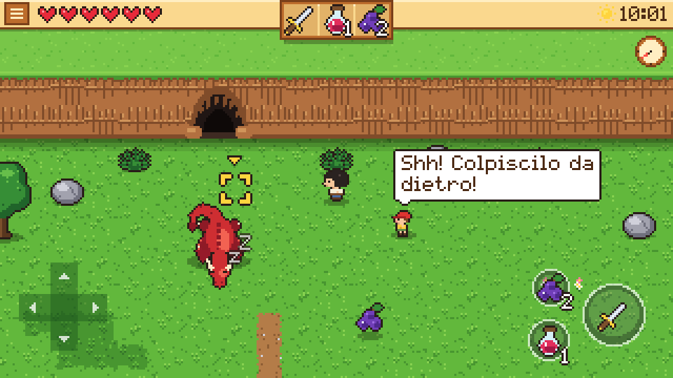
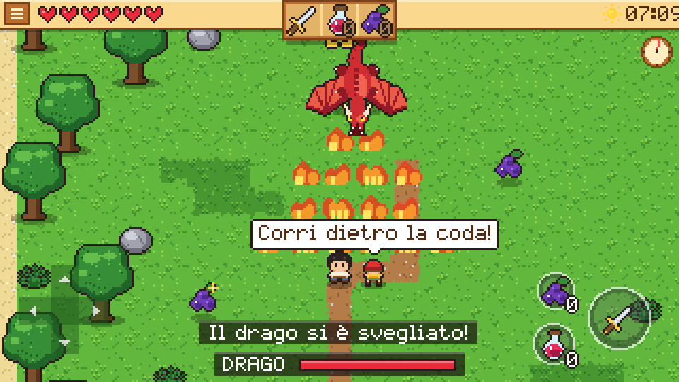

# La Tana del Drago

Gioco di ruolo d'azione in **Java 25** con interfaccia **JavaFX 25**, sviluppato per
l'esame di *Metodologie di Programmazione* (A.A. 2025/26).

Sull'isola, davanti a una grotta, dorme un drago. L'eroe deve sconfiggerlo, ma non è
solo: lo segue il **pupo**, un bambino che osserva il drago e indica a terra la casella
migliore da cui colpirlo. Chi colpisce dalla **casella dorata** fa il **doppio dei danni**;
quando il drago sta per attaccare, il pupo segna invece in **azzurro** dove mettersi al riparo.



## Come si avvia

Il progetto è scritto in **Java 25**. Per avviare Gradle basta un JDK 17 o successivo
(il comando `java` nel `PATH` oppure la variabile `JAVA_HOME`); per compilare e
avviare il gioco Gradle usa un **JDK 25**: quello installato sul computer oppure, se
manca, uno che scarica da solo. Al primo avvio Gradle scarica anche sé stesso e le
librerie (JavaFX, Gson, JUnit), quindi serve la connessione a Internet.

```bash
./gradlew build    # compila il progetto ed esegue i test
./gradlew run      # avvia il gioco
```

Su Windows si usano `gradlew.bat build` e `gradlew.bat run`.

## Come si gioca

| Azione | Tastiera | Mouse / touch |
|---|---|---|
| Muoversi | frecce oppure `W` `A` `S` `D` | croce direzionale in basso a sinistra |
| Attaccare | `Spazio` oppure `J` | pulsante con la spada |
| Bere una pozione (+3 cuori) | `Q` oppure `K` | pulsante con la pozione |
| Mangiare una bacca (+1 cuore) | `E` oppure `L` | pulsante con la bacca |
| Pausa e salvataggio | `Esc` oppure `P` | pulsante del menu in alto a sinistra |
| Confermare nei menu | `Invio` oppure `Spazio` | clic sulla voce |
| Schermo intero | `F11` | |

- **Il drago dorme**: se ti avvicini da dietro, il pupo ti indica la coda. Il primo colpo
  alle spalle è il più forte (consiglio del pupo ×2 e alle spalle ×1,5).
- **Gli attacchi del drago** sono sempre annunciati da caselle rosse: morso davanti alla
  testa, fiammata a cono, colpo di coda tutto intorno, volo con atterraggio sulla tua
  posizione. Dopo il colpo di coda il drago resta stordito per qualche istante.
- **Il pupo** cambia consiglio a seconda di cosa fa il drago: segue i lati scoperti e
  avvisa quando bisogna scappare. Fidati di lui!
- Quando il drago è ferito gravemente diventa **furioso** e attacca più in fretta.
- **Pozioni e bacche** sono sparse per l'isola; stare vicino al **falò** cura lentamente.
- L'orologio in alto scorre: sull'isola arriva anche la notte.



## Salvataggi e statistiche

Dal menu di pausa si salva la partita, che si riprende con **Continua** dal menu
principale. Il gioco tiene anche le statistiche di tutte le partite (vittorie, tempo
migliore, colpi, bonus ottenuti). I dati sono in formato JSON nella cartella
`.tana-del-drago` della cartella utente:

- `salvataggio.json` — la partita salvata (viene cancellata quando si vince);
- `statistiche.json` — le statistiche complessive.

## Struttura del progetto

Il progetto segue il pattern **Model-View-Controller**. Il *modello* contiene lo stato e
le regole del gioco e non sa nulla di grafica. Ogni schermata ha una *vista*, che legge il
modello in sola lettura (per esempio attraverso `VistaPartita`) e ne osserva gli eventi,
e un *controllore*, che legge i comandi del giocatore, li manda al modello e decide quale
schermata mostrare. La vista non conosce i controllori.

Tutte le classi stanno nel package `it.unicam.cs.mpgc.rpg132025`:

| MVC | Package | Contenuto |
|---|---|---|
| Modello | `modello` | le regole del gioco, senza grafica né file: mondo, eroe, drago, pupo, combattimento, oggetti, partita |
| Modello | `servizio` | `ServizioGioco`, i casi d'uso: nuova partita, salva, carica, registra la fine |
| Modello | `persistenza` | gli archivi per salvataggio e statistiche (interfacce) e la loro versione JSON |
| Vista | `vista` | le schermate e la grafica pixel-art: disegnano il modello senza modificarlo |
| Controllore | `controllore` | un controllore per schermata, la navigazione tra le schermate e il ciclo di gioco |
| | `input` | tasti, mouse e tocchi del giocatore, indipendenti dal dispositivo |
| | `piattaforma` | l'adattatore per JavaFX: finestra, tastiera, mouse e disegno su `Canvas` |
| | `avvio` | la composizione degli oggetti dell'applicazione |

Il livello è descritto da un file di testo (`src/main/resources/livelli/isola.txt`) e
tutta la grafica è disegnata dal codice, senza immagini esterne.

La relazione del progetto (funzionalità, responsabilità, classi e interfacce,
persistenza, estendibilità) è nella **Wiki** del repository.

## Tecnologie

Java 25, JavaFX 25, Gradle 9 (wrapper incluso, con toolchain Java 25), Gson per il
formato JSON, JUnit 5 per i test, GitHub Actions per compilare e provare ogni modifica.
Il codice usa le novità del linguaggio dove servono davvero: `record`, `switch` con
pattern matching e *record pattern*, variabili senza nome (`_`), *text block*,
`Math.clamp` e le collezioni ordinate (`getFirst`).

## Dichiarazione sull'uso dell'intelligenza artificiale

Durante lo sviluppo è stato usato **Claude** (Anthropic), un assistente basato su
intelligenza artificiale. L'assistente ha contribuito alla progettazione
dell'architettura, alla scrittura del codice Java.

> **Da completare a cura dell'autore:** descrivere qui, in modo sincero, che cosa è stato
> rivisto, modificato o scritto personalmente e come è stato verificato il funzionamento.
